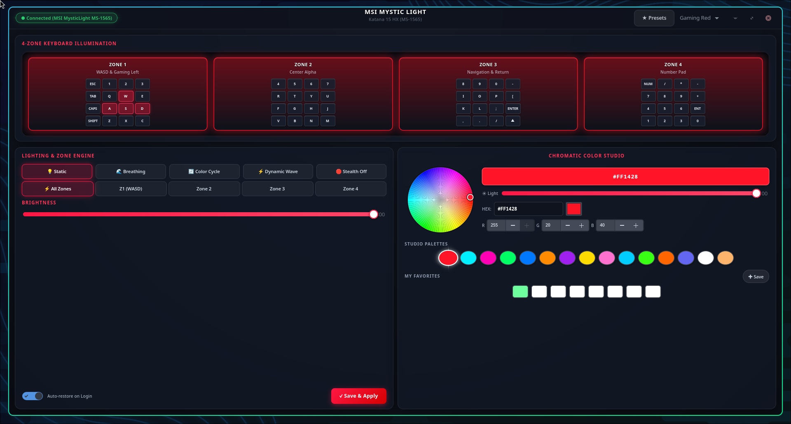

# MSI Mystic Light Linux RGB Controller

A modern, Apple & DaVinci-grade Linux RGB keyboard controller in **Rust** and **GTK4**, designed to replace MSI Center / Mystic Light for laptops such as the **MSI Katana 15 HX B14WGK** (`MS-1565` / USB VID:PID `1462:1601`).

<p align="center">
  
</p>

---

## 🌟 Key Features

* **Apple & DaVinci-Grade UI Design**: Ultra-refined glassmorphism, frosted dark card surfaces (`backdrop-filter`), luminescent accents, responsive layout, and high-DPI typography.
* **Interactive Cairo HSV Color Wheel**:
  * Real-time continuous 360° Hue and radial Saturation disc with smooth reticle tracking.
  * Dedicated Lightness / Value slider with live color preview.
  * Direct `#RRGGBB` Hex entry with instant bidirectional sync.
  * Precise RGB channel SpinButtons (0..255).
  * Curated Pro Studio & Gaming preset palette (MSI Dragon Red, Cyber Cyan, Neon Magenta, Matrix Emerald, Vaporwave Pink, Glacier Blue, Toxic Lime, Tokyo Indigo, Warm 2700K, Daylight 6500K).
  * Customizable **Favorites Swatches Bar** to bookmark and recall custom user colors.
* **4-Zone Independent & Synchronized Control**:
  * Zone 1 (WASD & Gaming Left cluster)
  * Zone 2 (Center Alpha)
  * Zone 3 (Navigation & Return)
  * Zone 4 (Numpad)
* **Real-time Dynamic Lighting Visualizer**: Interactive visual preview with authentic chiclet key matrix and multi-layered underglow that reacts dynamically to colors, brightness, and animations.
* **Direct Native Linux HID Driver (Zero External Dependencies)**:
  * Communicates directly with the MSI keyboard microcontroller via `/dev/hidraw*` using reverse-engineered HID Feature Reports (`HIDIOCSFEATURE`).
  * Instant connection (<1ms) and 100% native Rust.
* **Hardware Onboard Flash Persistence Across Reboots**:
  * Emits packet `0xA0` (Save to Flash) whenever colors or effects change.
  * **The keyboard hardware itself saves your configuration in internal EEPROM/Flash memory**: when your PC boots or restarts, the keyboard powers on with your chosen lighting at the BIOS / UEFI level without needing any background daemon!
* **Factory & Custom Profiles Studio**:
  * Built-in presets: *Spectrum Harmony*, *Chameleon Flow*, *Gaming Red*, *Cyberpunk Neon*, *Synthwave 84*, *Tokyo Night*, *Sunset Horizon*, *Matrix Code*, *Arctic Ice*, *Night Shift*, *Rainbow Wave*, *Stealth Off*.
  * Create, duplicate, delete, and designate startup default profiles with 4-zone preview dots.
* **Decoupled Architecture**: Fully isolated Domain and Backend layers with `RgbBackend` trait abstraction (supporting `NativeHidBackend` and `MockBackend`).
* **Zero Root / Sudo Required**: Direct non-root `/dev/hidraw*` access configured via udev rules.

---

## 📦 Installation

### From crates.io (Cargo)

```bash
cargo install msi-rgb
```

*(Note: Requires GTK4 development headers on your system, e.g. `sudo dnf install gtk4-devel` on Fedora or `sudo apt install libgtk-4-dev` on Ubuntu/Debian).*

### 1-Line Installer via `curl`

Install dependencies, compile, and configure the desktop application and autostart in a single command:

```bash
# Install to your user session (no sudo required)
curl -fsSL https://raw.githubusercontent.com/jeremylanes/msi-rgb/main/bin/install.sh | bash -s -- --user

# Or install system-wide (requires sudo)
curl -fsSL https://raw.githubusercontent.com/jeremylanes/msi-rgb/main/bin/install.sh | bash -s -- --system
```

### From Local Source Repository
```bash
./bin/install.sh --user
```

---

## 🚀 Quick Start

### 1. Launching GUI
```bash
# Directly via application menu or terminal command
msi-rgb

# Or from local source directory
./bin/msi-rgb
```

### 2. CLI Usage Examples
```bash
# List all configured profiles
./bin/msi-rgb --list-profiles

# Apply a profile instantly and exit
./bin/msi-rgb --profile "Spectrum Harmony"

# Apply startup default profile
./bin/msi-rgb --apply-default

# Run in offline simulation mock mode
./bin/msi-rgb --mock

# Run in headless background daemon mode
./bin/msi-rgb --daemon
```

### 3. Hyprland / Sway Keybindings Integration
Add the following to your `hyprland.conf`:
```ini
# Fast RGB Profile Switching
bind = $mainMod, F5, exec, msi-rgb --profile "Spectrum Harmony"
bind = $mainMod, F6, exec, msi-rgb --profile "Cyberpunk Neon"
bind = $mainMod, F7, exec, msi-rgb --profile "Night Shift"
bind = $mainMod, F8, exec, msi-rgb --profile "Stealth Off"
```

---

## 🛠 Project Structure

```text
msi_rgb/
├── bin/
│   ├── msi-rgb          # Application launcher
│   ├── run-tests        # Full verification suite (fmt, clippy, unit, doctest)
│   ├── package-rpm      # Fedora package staging helper
│   └── backup-config    # Configuration backup archiver
├── packaging/
│   ├── msi-rgb.spec     # RPM package specification
│   ├── 99-msi-rgb.rules # Linux udev rule for non-root hidraw access
│   ├── com.msi.mysticlight.rgb.desktop
│   └── com.msi.mysticlight.rgb.svg
├── src/
│   ├── main.rs          # CLI argument parser and runtime entry point
│   ├── lib.rs           # Core library exports
│   ├── domain/          # Pure business logic (Color with HSV, Effect, Zone, Device, Profile)
│   ├── backend/         # Hardware abstraction (RgbBackend trait, Native Linux HID, Mock)
│   ├── effects/         # Effect models and color palettes
│   ├── profiles/        # Preset management and factory profiles
│   ├── persistence/     # Atomic XDG storage with schema migration
│   ├── settings/        # App configuration
│   ├── infrastructure/  # Logging, autostart (XDG & systemd)
│   ├── app/             # Background async worker service and state handle
│   └── ui/              # GTK4 graphical interface (Cairo HSV wheel, visualizer, studio)
└── tests/               # Comprehensive unit and integration test suites
```

---

## 🧪 Testing & Verification

Run the test suite with one command:
```bash
./bin/run-tests
```
